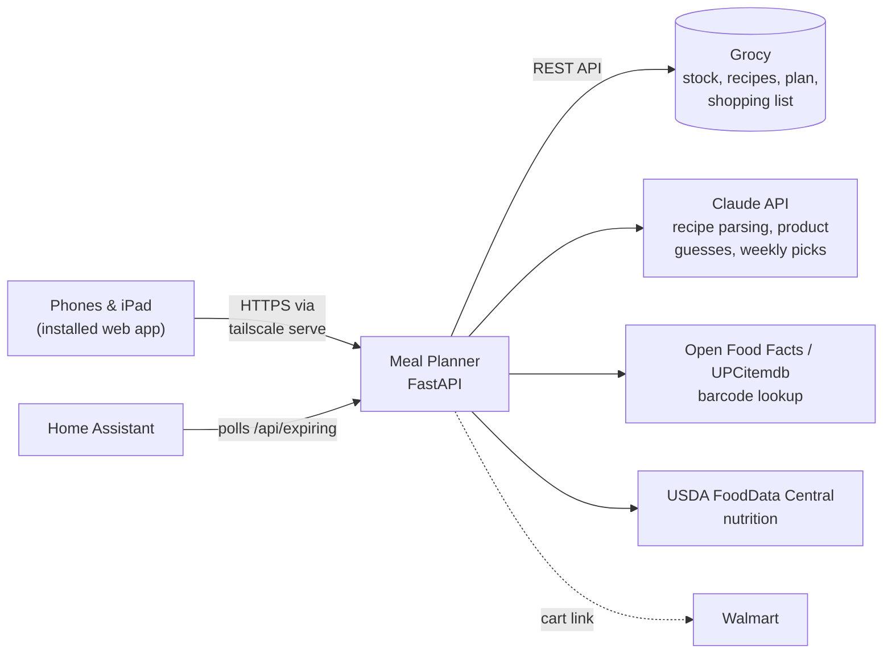

# Meal Planner

[](https://github.com/jhamlin461/meal-planner/actions/workflows/tests.yml)


A self-hosted kitchen app for a two-person household: it remembers what's in the house and where, warns before
food expires, plans the week's meals around what's on hand, and builds the shopping list — down to a ready-made
Walmart pickup cart.

Runs on a home server behind Tailscale, installs as an app on Android phones and an iPad, and uses
[Grocy](https://grocy.info) as its inventory database (through Grocy's API only — nobody uses Grocy's own UI)
and Claude for the parts that need judgement.

## Features

- **Recipe import** from meal-kit PDFs (EveryPlate cards and similar) and from recipe websites, in bulk.
  Kit "packets" are converted to real measurements, and kit-only seasoning blends to their spices.
- **Cooking for Engineers tables**: every recipe shows as a [cookingforengineers.com](https://www.cookingforengineers.com)
  style grid — ingredients down the left, each step spanning the ingredients it combines.
- **Portion scaling and macros** — calories, protein, carbs and fat per serving, from USDA FoodData Central.
- **Barcode-scanned pantry** with storage locations. Cooking a recipe deducts its ingredients automatically; any
  amount can be corrected by hand.
- **Expiry tracking** — a "use soon" list in the app and a Home Assistant notification.
- **Weekly plan**: dinners Monday–Friday with leftovers for the next day's lunch, lunch and dinner at the weekend.
  Suggestions favour what's expiring and what's already in stock.
- **Automatic shopping list** of everything the plan needs that isn't in the house, opened as a Walmart cart in one tap.

## How it fits together



Grocy holds all the state; the app is stateless apart from pending imports and the source PDFs.

## Stack

Python 3.12 · FastAPI · Jinja2 · vanilla JavaScript (installable PWA, ZXing barcode scanner) · httpx · Pydantic ·
Anthropic SDK · Grocy · Docker Compose · uv · pytest

## Running it

Deployment to a Proxmox LXC with Docker Compose and Tailscale is in **[deploy/README.md](deploy/README.md)**.
In short, inside the container:

```bash
git clone https://github.com/jhamlin461/meal-planner.git /root/meal-planner
bash /root/meal-planner/deploy/setup.sh   # asks for the keys, starts everything, sets up Grocy
```

Update with `git pull && cd deploy && docker compose up -d --build`.

### Configuration

`deploy/setup.sh` writes these to `deploy/.env` (git-ignored); see [deploy/.env.example](deploy/.env.example).

| Variable | Purpose |
|---|---|
| `GROCY_API_KEY` | Grocy API key (Grocy → user menu → Manage API keys) |
| `ANTHROPIC_API_KEY` | Claude API key |
| `FDC_API_KEY` | USDA FoodData Central key (`DEMO_KEY` works, rate limited) |
| `WALMART_STORE_ID` | Optional; pickup store for cart links |
| `SHOPPING_WEEKDAY` | Day the shopping list is built for, `0`=Mon … `6`=Sun |
| `EXPIRY_WARN_DAYS` | How many days ahead counts as "use soon" |
| `TZ` | Time zone (weekdays and expiry use the local date) |

## Development

```bash
uv sync
uv run pytest
```

The suite runs against in-memory fakes of Grocy and Claude, so it needs no server or API keys.
`tests/integration/` runs against a real Grocy when `GROCY_URL` and `GROCY_API_KEY` are set, and is skipped otherwise.

To run the app locally, point it at a Grocy instance:

```bash
GROCY_URL=http://<grocy-host>:9283/api GROCY_API_KEY=… ANTHROPIC_API_KEY=… DATA_DIR=./data \
  uv run uvicorn app.web:main_app --factory --reload
```

### Layout

| Path | What's there |
|---|---|
| `app/web.py` | Routes and pages |
| `app/importer.py`, `app/cfe.py` | Recipe import and the Cooking for Engineers table |
| `app/barcode.py`, `app/nutrition.py` | Product lookup by barcode and nutrition |
| `app/mealplan.py`, `app/suggest.py` | Week plan, cooking, AI suggestions |
| `app/shopping.py`, `app/walmart.py` | Shopping list and the Walmart cart |
| `app/grocy.py`, `app/setup_grocy.py` | Grocy API client and one-time Grocy setup |
| `deploy/` | Dockerfile, Compose file, setup script, Home Assistant config |
| `docs/superpowers/` | Design spec and implementation plan |
